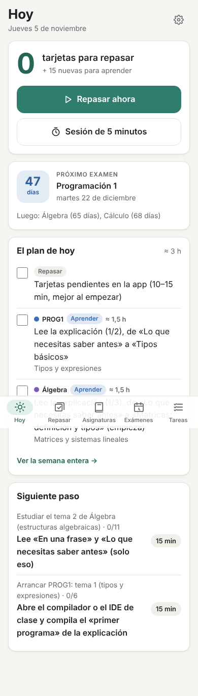
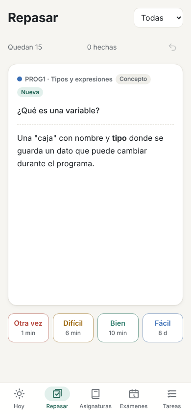
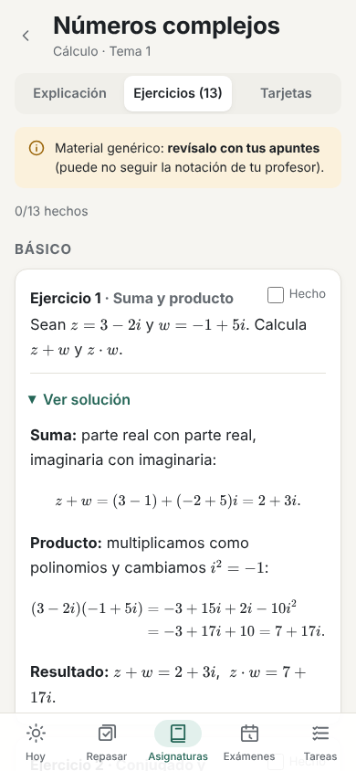
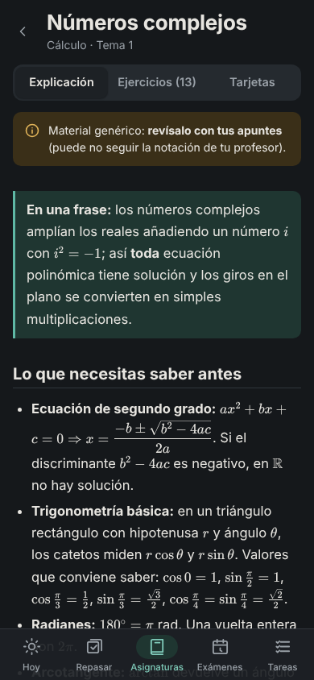

# Estudio — mi sistema para toda la carrera

Dos piezas que se hablan solo a través de ficheros de este repo:

1. **Skills de Claude Code** (`.claude/skills/`): convierten mis apuntes en explicaciones, ejercicios
   con soluciones y tarjetas; me hacen el plan de exámenes; trocean tareas; me ayudan con las
   prácticas sin hacérmelas.
2. **Una web app (PWA)** que muestra ese material y hace **repaso espaciado** (FSRS). Funciona sin
   conexión, se instala en el móvil y **no usa ninguna IA ni necesita claves**.

👉 **App:** <https://gonzalo-aragues.github.io/STUDY-APP/> (tras activar GitHub Pages, ver `RESUMEN.md`).

<p>
  
  
  
  
</p>

---

## Cómo usarlo

### La primera vez (una sola vez)

1. En GitHub: **Settings → Pages → Source: "GitHub Actions"**.
2. Abre la app en el móvil y **"Añadir a pantalla de inicio"** (Chrome: menú ⋮ → *Instalar app*;
   Safari: compartir → *Añadir a pantalla de inicio*). Desde el icono, un toque y estás repasando.
3. En el ordenador (para usar las skills): `npm install` dentro del repo y abre Claude Code aquí.

### Cada día (sin tener que decidir nada)

1. Abre la app → **Hoy**: cuántas tarjetas tocan, cuánto falta para el próximo examen y qué dice
   el plan para hoy.
2. Pulsa **Repasar ahora** (o **Sesión de 5 minutos** si no tienes ganas: suele bastar para arrancar).
3. Haz los bloques del plan de hoy en el orden que quieras y márcalos ✓.
4. ¿Un bloque te parece enorme? Pídele a Claude Code: *«divide estudiar el tema 2 de Álgebra»*
   y aparecerá en **Tareas** en pasos de 15–25 minutos.

### Añadir una asignatura

En Claude Code: *«añade la asignatura Matemática Discreta, examen el 10 de junio, temas: lógica,
conjuntos, combinatoria»* (skill **nueva-asignatura**). O a mano:

```bash
npm run nueva-asignatura -- --nombre "Matemática Discreta" --abreviatura MD --semestre 2026-27-S2 --examen 2027-06-10 --temas "Lógica; Conjuntos; Combinatoria"
```

Crea `asignaturas/<slug>/` con `meta.json`, `apuntes/` y `temas/`. Fechas o nombres se cambian
luego editando `meta.json` (formato en [`schemas/README.md`](schemas/README.md)).

### Dejar apuntes y generar el material

1. Copia tus apuntes en `asignaturas/<slug>/apuntes/`: **PDF, fotos de la pizarra o del cuaderno,
   o `.md`**. Nombra los ficheros con el tema si puedes (`tema2-grupos.pdf`).
2. En Claude Code: *«genera el material del tema 2 de álgebra»* (skill **apuntes-a-material**).
   Crea `explicacion.md`, `ejercicios.md` (básico / medio / tipo examen), `soluciones.md` (aparte)
   y `tarjetas.json`, siguiendo la notación de tu profesor.
3. Revisa lo generado. Cuando esté bien, en `meta.json` pon ese tema como `"estado": "revisado"`.
4. `git add -A && git commit -m "Tema 2 de Álgebra" && git push` → en 1–2 minutos está en la app.

> Lo que ahora hay en el repo es **material genérico** (no había apuntes): verás el aviso
> *"revísalo con tus apuntes"*. Cuando tengas los apuntes, vuelve a pasar la skill por ese tema.

### Qué skill uso para qué

| Quiero… | Le digo a Claude Code… | Skill |
|---|---|---|
| Entender algo desde cero | «explícame qué es un anillo desde cero» | `explicar-desde-cero` |
| Material de un tema desde mis apuntes | «genera el material del tema 3 de cálculo» | `apuntes-a-material` |
| Ayuda con una práctica **sin que me la hagan** | «ayúdame con la práctica 2, no compila» | `tutor-practicas` |
| Plan hasta los exámenes | «hazme el plan» / «me he retrasado, rehaz el plan» | `plan-de-examenes` |
| Trocear algo enorme | «divide preparar el examen de FAE» | `dividir-tarea` |
| Nueva asignatura / nuevo semestre | «añade la asignatura X» / «empiezo el segundo cuatrimestre» | `nueva-asignatura` |

Las prácticas van en `asignaturas/<slug>/practicas/<nn-nombre>/` (enunciado + tu código).
El tutor da pistas en escalera (pequeña → grande → pseudocódigo) y señala líneas concretas.

### El plan de estudio

- `plan/plan.md` es para leer; `plan/plan.json` lo usa la app (Hoy y "Ver la semana entera").
- Horas disponibles y días especiales (festivos, días que no puedes) en `plan/config.json`.
- **Si te retrasas, no intentes recuperarlo todo**: pide *«rehaz el plan desde hoy»* o
  `npm run plan` y se recalcula.

### Copia de seguridad del progreso

Tu progreso (tarjetas, repasos, pasos marcados, ejercicios hechos) vive **solo en el móvil**
(IndexedDB). El contenido está en GitHub, pero el progreso no.

- **Ajustes (⚙️ en Hoy) → Exportar copia de seguridad**: descarga `estudio-copia-AAAA-MM-DD.json`.
  Guárdala en Drive o envíatela por correo. La app te avisa si llevas más de 14 días sin copia.
- **Importar copia de seguridad**: reemplaza el progreso del dispositivo por el de la copia
  (para cambiar de móvil o si borras los datos del navegador).
- En Ajustes puedes pedir **almacenamiento persistente** para que el navegador no borre nada.

### Nuevo semestre

En Claude Code: *«empiezo el segundo cuatrimestre, archiva el primero»* (skill **nueva-asignatura**,
flujo B). O a mano:

```bash
npm run nuevo-semestre -- --semestre 2026-27-S1 --dry-run
npm run nuevo-semestre -- --semestre 2026-27-S1
```

Mueve las asignaturas de ese semestre a `archivo/2026-27-S1/` (no borra nada), archiva el plan y
las tareas. En la app siguen en **Asignaturas → Archivadas** y su historial de repaso se conserva.
Si suspendes una, no la archives: cámbiale `semestre` y fechas en su `meta.json`.

---

## Para desarrollar

```bash
npm install
npm run dev          # app en local: http://localhost:5173/STUDY-APP/
npm run validate     # schemas, ejercicio ↔ solución, LaTeX
npm run check-code   # compila y ejecuta los programas C++ de las soluciones
npm test             # tests unitarios (vitest)
npm run build        # validate + índice + build en dist/
npm run e2e          # pruebas en navegador (necesita build y Playwright)
node scripts/screenshots.ts   # capturas a 390 px y escritorio en screenshots/
```

Estructura, convenciones y cómo encajan las skills: [`CLAUDE.md`](CLAUDE.md). Decisiones de diseño:
[`DECISIONS.md`](DECISIONS.md). Resumen de lo construido y pasos manuales: [`RESUMEN.md`](RESUMEN.md).
